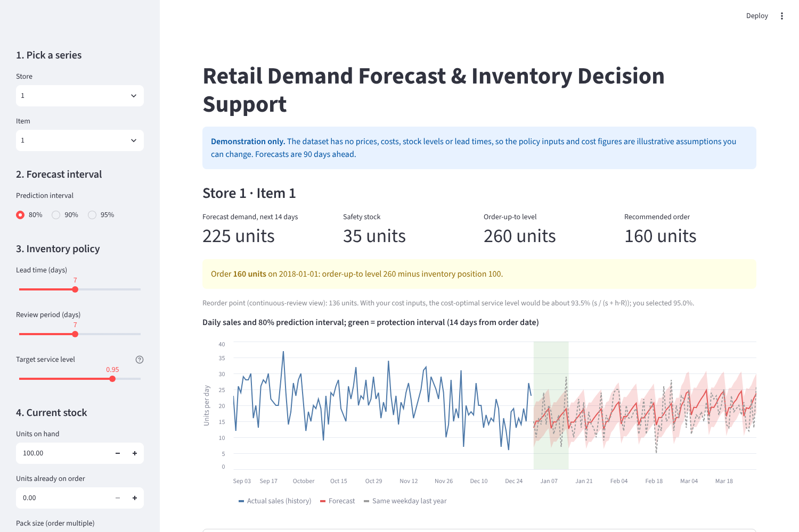
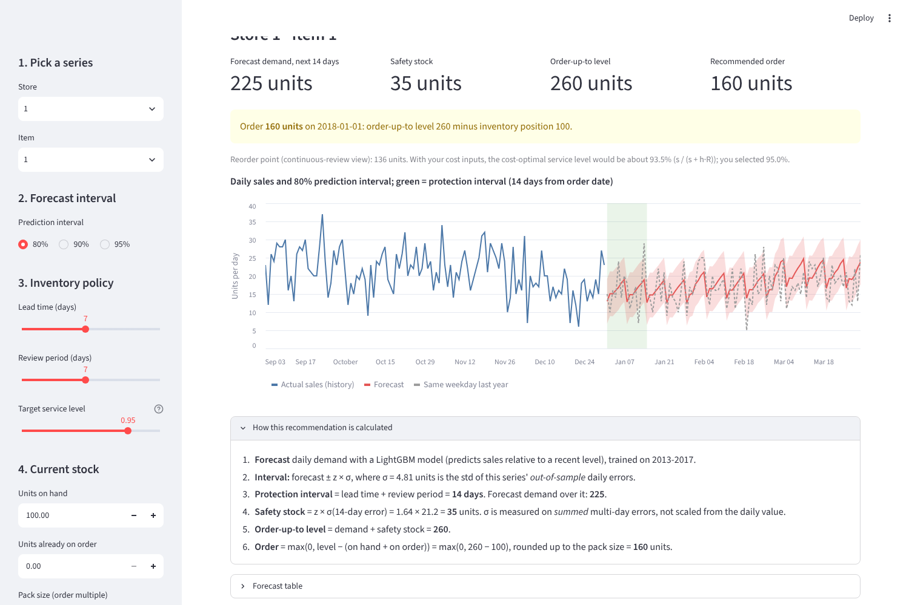
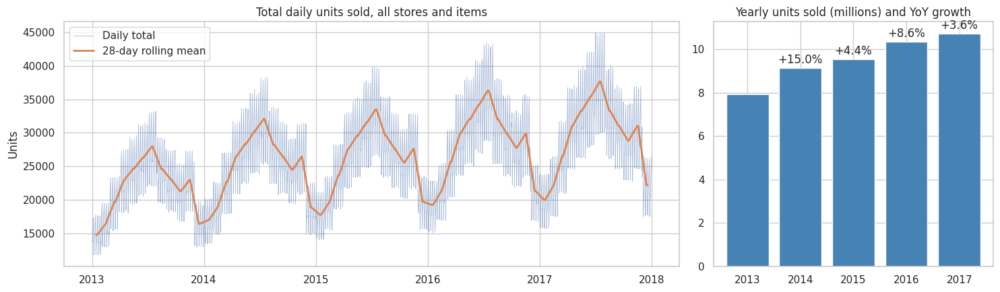
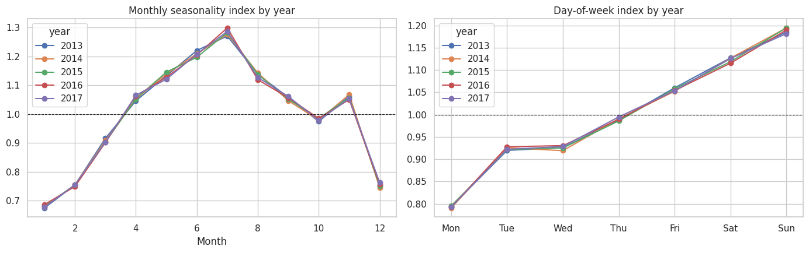
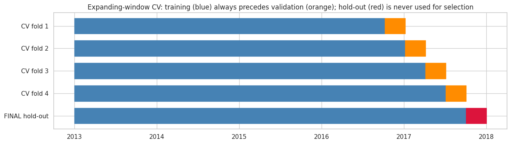
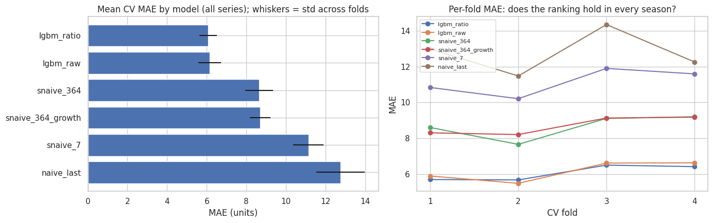
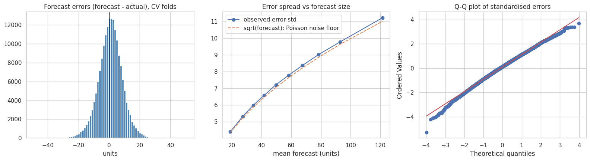
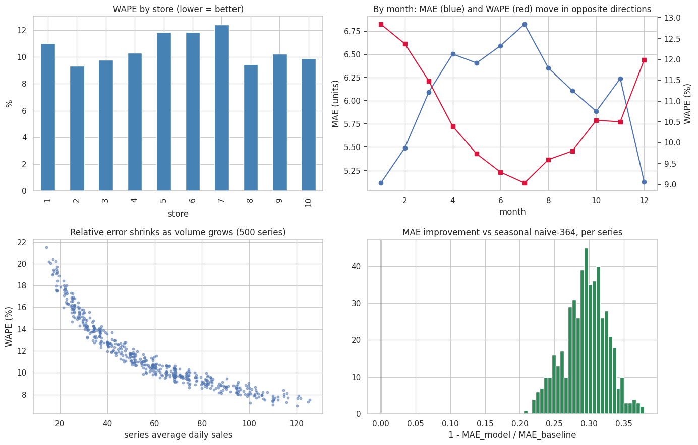
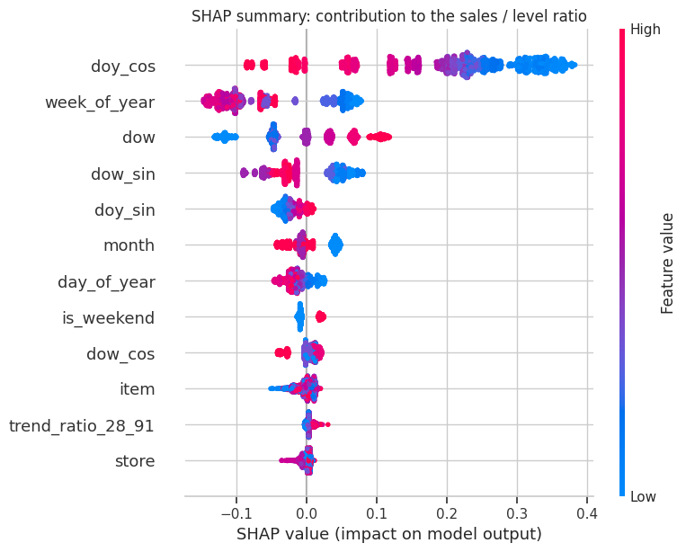
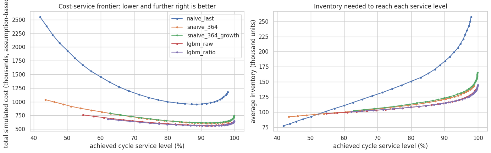

# Retail Demand Forecasting & Inventory Decision Support

End-to-end demand forecasting for 500 store-item series (10 stores × 50 items), turned into inventory decisions (safety stock, reorder points, order quantities) and served through a Streamlit app. The project is built around one question: **does a better forecast change an ordering decision, and by how much?**

**Headline results** (details and caveats below):

- On an untouched 90-day hold-out, a global LightGBM model has **30.6% lower MAE** than the seasonal-naive baseline (5.79 vs 8.35 units/day; sMAPE 12.2% vs 17.9%). Cross-validation showed the same gap (29.8%).
- At a 95% service target it needs **21.7% less safety stock** than seasonal naive.
- In an **assumption-based inventory simulation**, it is **8.1% cheaper** than seasonal naive at matched service. The result ranges from roughly break-even to about 32% cheaper depending on the assumed stockout cost. These are simulated figures, not real savings (see [Limitations](#6-limitations)).



The Streamlit app runs locally in one command (see [How to run](#7-how-to-run)); it needs only the small files in `app/artifacts/`, not the raw data.

## Contents

1. [Problem](#1-problem)
2. [Data](#2-data)
3. [Approach](#3-approach)
4. [Results](#4-results)
5. [Key insights](#5-key-insights)
6. [Limitations](#6-limitations)
7. [How to run](#7-how-to-run)
8. [Repository structure](#8-repository-structure)
9. [Reproducibility notes](#9-reproducibility-notes)
10. [Future work](#10-future-work)

---

## 1. Problem

A multi-store retailer must decide how many units of each item to order for each store *before* demand is known. Under-ordering loses sales; over-ordering ties up cash and shelf space.

| Stakeholder | Decision | What they need from the forecast |
|---|---|---|
| Store operations | Replenishment orders | Point forecast + recommended order quantity |
| Supply chain planning | Safety stock, reorder points | Forecast *uncertainty*, not just the mean |
| Merchandising | Which items are volatile | Error by item |
| Finance | Working capital vs. lost-sales risk | Cost comparison under stated assumptions |

**Success is measured two ways:** forecast accuracy (MAE, RMSE, sMAPE, bias; evaluated only out-of-time) and simulated inventory cost and service level.

## 2. Data

[Kaggle "Store Item Demand Forecasting Challenge"](https://www.kaggle.com/competitions/demand-forecasting-kernels-only): `train.csv` with daily sales for 10 stores × 50 items from 2013-01-01 to 2017-12-31 (913,000 rows, complete panel, no missing values, no duplicates). The data is **not** included in this repository (see [`data/README.md`](data/README.md)).

The data is anonymized: it has no prices, promotions, stock levels, lead times or costs. Everything cost-related in this project is therefore an explicit assumption.

## 3. Approach

| Stage | What was done |
|---|---|
| EDA | Data audit, trend, yearly/weekly seasonality, store/item differences, anomaly check (562 flagged days, 0.062%, spread evenly across stores; nothing removed) |
| Features | Calendar, cyclical, lag and rolling features, all built to be known **91+ days ahead** (see below) |
| Validation | Expanding-window time-series CV (4 folds × 90 days) + a final 90-day hold-out evaluated once |
| Models | Naive and seasonal-naive baselines; ETS, SARIMAX (Fourier terms), Prophet on a 12-series subset; global LightGBM on all 500 series |
| Diagnostics | Residual shape, error by horizon / store / item / month / weekday, SHAP, ablations |
| Business layer | Safety stock, order-up-to levels and a day-by-day inventory simulation under adjustable assumptions |
| Deployment | Streamlit app with prediction intervals and a recommended order quantity |

### Leakage control

The forecast horizon is 90 days, so **every sales-derived feature for date *t* uses only sales from *t − 91* or earlier** (91 = 13 weeks, which keeps the weekday aligned). Lags are 91, 98, 105, 112, 182 and 364 days; rolling windows (7, 28, 91 days) are computed on a series shifted by 91 days.

This is verified, not assumed: a perturbation test replaces all sales after a cutoff date with random numbers, rebuilds the features, and asserts that every row within the safe window is unchanged. A second test compares lags against independent lookups in the raw data. A side benefit: one precomputed feature table is valid in every CV fold.

### Validation design

- 4 expanding-window folds, each validating on 90 days; together they cover a full year (2016-10-08 to 2017-10-02), so every season is tested.
- Final hold-out: 2017-10-03 to 2017-12-31. Models and settings were chosen on CV only; the hold-out was evaluated once, after the model was frozen.
- No random splits anywhere.

### Models

- **Baselines:** naive (last value), seasonal naive (7-day), seasonal naive (364-day, same weekday last year), and seasonal naive with a growth adjustment.
- **Classical (12-series subset, chosen by volume rank only):** ETS (damped trend, weekly seasonality), SARIMAX(1,0,1)(1,1,1,7) with yearly Fourier terms, Prophet (additive and multiplicative).
- **Global LightGBM (all 500 series):** 30 features, 300 trees, learning rate 0.05, plain L2 loss. Two target formulations: raw sales, and the **ratio** `sales / roll_mean_91`, multiplied back by the level, which helps trees cope with trend.

### Inventory translation

Periodic-review order-up-to policy with lost sales: every R days, order up to **S = forecast demand over (lead time + R) days + z × σ**, where σ is the standard deviation of forecast error *summed over that window*, measured directly on cross-validation residuals (about 12% larger than the independence shortcut σ·√k). Costs are evaluated on the untouched hold-out.

Assumptions (all illustrative placeholders, adjustable in the notebook and the app): lead time 7 days, review period 7 days, holding cost $0.05 per unit per day, stockout cost $5 per unit, 95% target service level.

## 4. Results

### 4.1 Hold-out (2017-10-03 to 2017-12-31, all 500 series)

| Model | MAE | RMSE | sMAPE % | Bias |
|---|---|---|---|---|
| **LightGBM (ratio target)** | **5.792** | **7.504** | **12.23** | −0.121 |
| LightGBM (raw target) | 5.963 | 7.763 | 12.54 | −0.753 |
| Seasonal naive + growth | 8.342 | 10.862 | 17.61 | −0.125 |
| Seasonal naive (364d) | 8.350 | 10.897 | 17.87 | −2.271 |
| Seasonal naive (7d) | 11.649 | 15.413 | 22.27 | +6.164 |
| Naive (last value) | 13.270 | 17.653 | 27.47 | −8.805 |

Bias = mean(forecast − actual), in units per day. LightGBM (ratio) improves on seasonal naive by 30.6% (MAE), 31.1% (RMSE) and 5.6 sMAPE points, and on plain naive by 56.4% (MAE).

### 4.2 Cross-validation (mean of 4 folds, all 500 series)

| Model | MAE | MAE std across folds | RMSE | sMAPE % | Bias |
|---|---|---|---|---|---|
| LightGBM (ratio target) | 6.067 | 0.448 | 7.853 | 12.13 | +0.750 |
| LightGBM (raw target) | 6.151 | 0.564 | 8.008 | 12.28 | −0.855 |
| Seasonal naive (364d) | 8.639 | 0.706 | 11.250 | 17.55 | −2.633 |
| Seasonal naive + growth | 8.702 | 0.521 | 11.299 | 17.28 | +0.530 |
| Seasonal naive (7d) | 11.132 | 0.763 | 14.674 | 21.35 | −1.099 |
| Naive (last value) | 12.764 | 1.222 | 16.932 | 24.00 | −2.220 |

The ratio target won three of four folds. The margin over the raw target is small (about 1.4% in mean MAE), so the two are best regarded as similar, with the ratio version better calibrated (bias nearer zero).

### 4.3 Model families on a 12-series subset (CV mean, identical series and folds)

| Model | MAE | RMSE | sMAPE % | Bias |
|---|---|---|---|---|
| LightGBM (ratio target) | 5.958 | 7.755 | 12.37 | +0.656 |
| LightGBM (raw target) | 6.134 | 8.088 | 12.57 | −0.910 |
| Prophet (multiplicative) | 6.339 | 8.367 | 12.93 | +0.492 |
| Prophet (additive) | 6.694 | 8.853 | 13.46 | +0.407 |
| SARIMAX + Fourier | 6.775 | 8.993 | 13.57 | −1.423 |
| Seasonal naive (364d) | 8.480 | 11.129 | 17.67 | −2.513 |
| Seasonal naive + growth | 8.582 | 11.200 | 17.55 | +0.379 |
| ETS (weekly seasonality only) | 9.732 | 12.877 | 18.78 | −1.597 |
| Seasonal naive (7d) | 10.897 | 14.462 | 21.54 | −1.868 |
| Naive (last value) | 12.328 | 16.267 | 24.21 | −2.001 |

The subset is a representative sample (12 series spread evenly across the volume ranking). Baselines and LightGBM score within about 2% of their all-series values on it. Fitting SARIMAX for 12 series × 4 folds took about 4 minutes, while LightGBM handled all 500 series in about 1.5 to 2 minutes. **The same 12 series on the hold-out (2017-10-03 to 2017-12-31):**

| Model | MAE | RMSE | sMAPE % | Bias |
|---|---|---|---|---|
| LightGBM (ratio target) | 5.590 | 7.319 | 12.26 | −0.217 |
| LightGBM (raw target) | 5.915 | 7.812 | 12.73 | −1.027 |
| Prophet (multiplicative) | 6.255 | 8.209 | 13.57 | −0.292 |
| Prophet (additive) | 6.310 | 8.263 | 13.57 | +1.026 |
| SARIMAX + Fourier | 7.020 | 9.396 | 14.59 | +0.568 |
| Seasonal naive + growth | 8.307 | 10.756 | 17.95 | −0.534 |
| Seasonal naive (364d) | 8.422 | 11.029 | 18.33 | −3.019 |
| ETS (weekly seasonality only) | 9.551 | 13.275 | 18.44 | +4.996 |
| Seasonal naive (7d) | 11.854 | 16.138 | 23.18 | +5.674 |
| Naive (last value) | 15.812 | 21.485 | 31.70 | −12.731 |

On this subset's hold-out, LightGBM's MAE is 10.6% lower than the best Prophet variant (in CV the gap was 6.0%). Both are single-window or 12-series comparisons, so read the ordering as indicative. ETS and SARIMAX are optimizer-based fits that did not fully converge, so their last digits can differ slightly between machines (by up to about 0.004 MAE in my checks). The per-model tables are also saved in `results/` (the two `*_subset12.csv` files come from the notebook's last cell).

### 4.4 Inventory simulation on the hold-out (**assumption-based simulation, not real savings**)

**Safety stock at a 95% target** (depends only on forecast error, not on any cost assumption):

| Model | Total safety stock (units) | vs. seasonal naive |
|---|---|---|
| Seasonal naive (364d) | 33,594 | baseline |
| Seasonal naive + growth | 37,583 | +11.9% |
| LightGBM (raw target) | 25,353 | −24.5% |
| **LightGBM (ratio target)** | **26,300** | **−21.7%** |
| Naive (last value) | 123,026 | +266% |

**Cost at matched service** (smallest safety factor that reaches at least 95% cycle service, chosen per model for comparison only):

| Model | Holding cost | Stockout cost | Total cost | vs. seasonal naive |
|---|---|---|---|---|
| Seasonal naive (364d) | 591,092 | 23,672 | 614,764 | baseline |
| Seasonal naive + growth | 602,800 | 21,901 | 624,701 | +1.6% |
| LightGBM (raw target) | 549,217 | 22,542 | 571,759 | −7.0% |
| **LightGBM (ratio target)** | **545,583** | **19,668** | **565,251** | **−8.1%** |
| Naive (last value) | 992,703 | 48,224 | 1,040,927 | +69.3% |

Costs are in the illustrative currency units of the assumptions above. Holding cost is about 97% of the total, because most inventory is cycle stock that no forecast can remove. That is why the safety-stock reduction (21.7%) is larger than the total-cost reduction (8.1%).

**A caution on service levels.** With the *same* safety factor (z = 1.645), seasonal naive delivered only 86.3% cycle service against a 95% target (its systematic under-forecast is not captured in its error spread), while LightGBM (ratio) delivered 96.4%. The matched-service table above corrects for that.

**Sensitivity to the stockout-cost assumption** (LightGBM ratio vs. seasonal naive, total cost change at a fixed service *target*; this grid does not match achieved service, so part of the gap reflects the baseline under-delivering service):

| Stockout cost / unit | 90% target | 95% target | 98% target |
|---|---|---|---|
| $2 | −3.5% | −0.5% | +1.2% |
| $5 (default) | −14.7% | −8.1% | −2.9% |
| $10 | −27.6% | −18.1% | −8.9% |
| $20 | −42.5% | −31.9% | −18.8% |

When stockouts are cheap and the service target is very high, the model's advantage disappears. The conclusion depends on the stockout cost, and no single figure should be quoted without this range.

### 4.5 Streamlit app



Pick a store and item, choose a prediction interval, set lead time, review period, service level and current stock, and the app shows the 90-day forecast, safety stock, the order-up-to level and a recommended order quantity, with the calculation spelled out. Prediction intervals (forecast ± z × σ, with σ from out-of-sample errors) were checked on the hold-out: nominal 80%, 90% and 95% intervals covered 82.0%, 91.2% and 95.8% of hold-out days (calibrated on cross-validation residuals only).

### 4.6 Selected figures

| | |
|---|---|
|  |  |
|  |  |
|  |  |
|  |  |

All eleven notebook figures are in [`docs/figures/`](docs/figures/).

## 5. Key insights

1. **The honest baseline is seasonal naive**, not naive. Same weekday last year already removes about a third of naive's error, so a model's value should be judged against it.
2. **The model is close to the noise floor.** Forecast-error standard deviation is about 1.02 × √(forecast) in every one of ten forecast-size bins, which is what count noise alone would produce. Only about 4% of error variance is left for a better model to remove, so further tuning has little to gain. Residuals are close to normal (skew −0.18, excess kurtosis 0.11) and show almost no autocorrelation (about 0.02), which supports the normal-approximation safety-stock formula.
3. **Error does not grow with horizon** (MAE is flat from day 1 to day 90), a direct result of the 91-day feature design.
4. **The gain is uniform.** The model beats seasonal naive on CV in all 500 series and in every store (about 29 to 30% lower MAE per store; per-series improvement from 20.6% to 37.9%, median 29.7%).
5. **Percentage and unit errors disagree.** July has the highest MAE (6.83) but one of the lowest WAPEs (9.0%); January is the reverse (MAE 5.12, WAPE 12.8%). MAPE also penalizes over-forecasts more than under-forecasts and breaks at zero, so MAE/RMSE and WAPE were used for decisions and sMAPE for cross-series comparison.
6. **Calendar structure dominates.** Calendar features hold 93.7% of mean |SHAP|. Dropping the holiday flag or all six lag features leaves CV MAE at 6.071 versus 6.067 for the full model, so they are redundant once a recent level is available. A leaner model performs equally well.
7. **Bias, not just accuracy, drives inventory cost.** The over-forecast in January to April (+1.7 to +2.3 units/day) is invisible in aggregate MAE; seasonal naive's under-forecast caused it to miss its service target.
8. **Accuracy and cost can rank models differently.** Seasonal naive with a growth adjustment matches seasonal naive on MAE (8.342 vs 8.350) but needs 12% more safety stock because its error spread is wider.

## 6. Limitations

- **No real cost, price, lead-time or stock data.** All inventory figures are assumption-based simulations that show how forecast quality *would* translate under stated inputs. They are not measured savings.
- **Sales are treated as demand.** Any past stockouts understate true demand (the data contains only one zero-sales row, so stockouts cannot be diagnosed from it).
- **The dataset behaves like clean, count-like data** (error variance tracks Poisson noise; effects are mostly smooth calendar patterns). Accuracy on real retail data, with promotions, weather, stockouts and heavier tails, would likely be lower.
- **90-day-ahead forecasts by design.** A live replenishment system would use fresher information, so these error spreads are probably conservative.
- **One bias pattern remains.** The model over-forecasts in January to April 2017. A plausible but untested explanation is the slower 2017 growth (+3.6% vs +8.6% in 2016). Correcting for the bias with a per-series offset did not help in tests, because the bias is seasonal.
- **Simplified policy:** one lead time, review period and cost for all series; lost sales; no pack sizes, minimum order quantities or shelf life; normal-approximation safety stock.
- **Single 90-day hold-out window.** Treat percentage figures as indicative.
- **Subset results** for ETS, SARIMAX and Prophet cover 12 series; they should not be generalized beyond that sample.
- The US federal holiday calendar used in feature engineering is an assumption (the dataset's country is unknown); ablations showed it adds nothing.

## 7. How to run

**Requirements:** Python 3.10+ (developed on Google Colab with Python 3.13).

1. **Clone and install**
   ```bash
   git clone https://github.com/PritheshBijlani/retail-demand-forecasting.git
   cd retail-demand-forecasting
   pip install -r requirements.txt
   ```
2. **Get the data** (manual download, no API): follow [`data/README.md`](data/README.md) and place `train.csv` in `data/raw/`.
3. **Run the notebook** `notebooks/demand_forecasting_end_to_end.ipynb` top to bottom, in Colab or locally. Set `PROJECT_DIR` in the config cell to the folder where intermediate files should be written. On free Colab the full run takes roughly 20 to 30 minutes; the longest steps are SARIMAX (about 4 min), LightGBM cross-validation (about 4 min) and the ablations (about 3 min). The hold-out cell is guarded by the `RUN_HOLDOUT` flag, which is `True` in the committed notebook; keep it `False` while you are still changing features or models and flip it once the model is frozen.
4. **Run the app**
   ```bash
   cd app
   pip install -r requirements.txt
   streamlit run app.py
   ```
   The app reads only the small files in `app/artifacts/`, so it runs without the raw data or the notebook.

## 8. Repository structure

```
retail-demand-forecasting/
├── README.md
├── LICENSE                          # MIT
├── requirements.txt                 # analysis environment
├── .gitignore
├── data/
│   └── README.md                    # how to download train.csv (data not committed)
├── notebooks/
│   └── demand_forecasting_end_to_end.ipynb
├── app/
│   ├── app.py                       # Streamlit app
│   ├── requirements.txt             # app-only dependencies
│   └── artifacts/                   # forecasts, history, calibration, metrics (about 2 MB)
│       ├── forecast.csv
│       ├── history_last365.csv.gz
│       ├── calibration.csv
│       ├── metrics.json
│       └── assumptions.json
├── results/                         # small CSV tables behind the numbers above
│   ├── holdout_metrics_all_series.csv
│   ├── holdout_metrics_subset12.csv
│   ├── cv_leaderboard_all_series.csv
│   ├── cv_leaderboard_subset12.csv
│   ├── inventory_results_target_service.csv
│   ├── inventory_results_matched_service.csv
│   └── inventory_sensitivity.csv
└── docs/
    └── figures/                     # 01-11: notebook figures, app_*.png: app screenshots
```

## 9. Reproducibility notes

- Random seed 42 throughout. LightGBM: 300 trees, learning rate 0.05, 63 leaves, `min_data_in_leaf` 100, feature and bagging fraction 0.8, L2 regularization 1.0.
- The hold-out was evaluated once, after the model and features were frozen; later experiments (ablations, sensitivity) used cross-validation or varied only the business assumptions.
- Exact metrics can differ in the last digit across machines, because LightGBM's multithreading and single-feature importance rankings vary slightly; the headline metrics and group-level SHAP shares were identical across two environments in my checks.
- `requirements.txt` sets minimum versions (the releases the app and dependencies were checked against in October 2026, Python 3.13); the notebook results themselves were produced on Google Colab. For an exact environment, run `pip freeze` after installing.

## 10. Future work

- Replace the assumed costs with real ones, and re-run the simulation with real lead times and stock records.
- Add shorter-horizon models that use fresh lags, and compare them with the 90-day design in the same inventory simulation.
- Replace normal intervals with conformal or quantile-based intervals to handle the slightly heavier upside tail.
- Add promotions, prices and stockout flags (to model censored demand) on a real retail dataset.
- Monitor bias by month in production and retrain on a schedule.

## Author

Prithesh, Business Analytics, Medicaps University (Indore, India).

Released under the [MIT License](LICENSE).

Data: Kaggle Store Item Demand Forecasting Challenge. Please respect the competition's terms; the raw data is not redistributed here.
